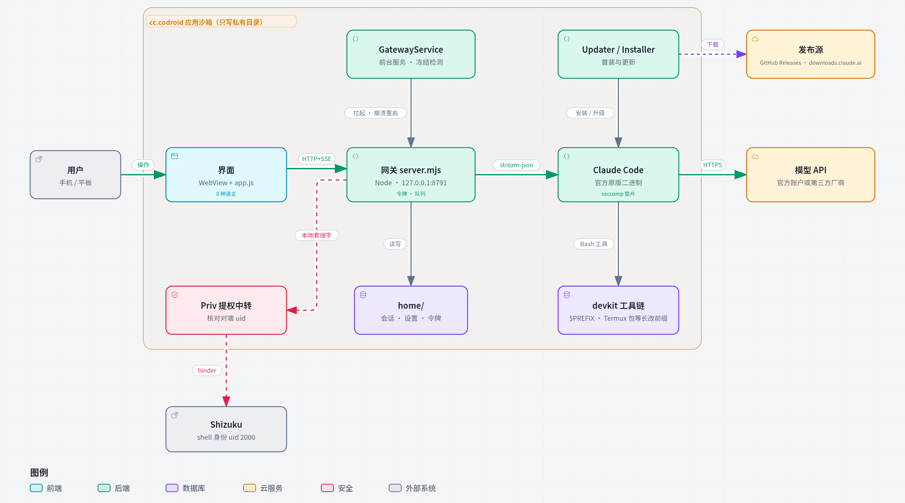

# cccodroid

[English](README.md) · **简体中文**

**在安卓手机上运行 Claude Code 的开发启动台。** 不 root、不换系统、不走 chroot / proot / 虚拟机。

安卓底层本来就是 Linux 内核。只要工具能在这套内核上原生跑起来，手机就能直接用来做 AI 辅助开发：
写代码、编译 C/C++、跑 Python / Node、打 APK、用 git 推送，全部在手机上完成。

> cccodroid 是第三方项目，与 Anthropic 无关。它运行的是 **官方原版 Claude Code**：
> 安装时从 Anthropic 官方渠道下载，按官方清单校验 sha256，不做任何修改。


## 为什么

在手机上用 AI 干活，模型要真正动手（跑代码、改文件、打包）时，通常得把任务送进云端沙箱，手机只是一块显示屏。
cccodroid 让执行回到你自己的设备上：云端只负责模型推理，代码、文件、工具链都留在本地，环境不会随会话销毁，还能直接触达设备本身。
这套做法不绑定某一个代理，任何能在 Linux arm64 上运行的命令行 AI 代理都能这样搬上手机。

详见 **[设计哲学](docs/design-philosophy.zh-CN.md)**。

## 能做什么

- **官方 Claude Code + 图形界面**：对话、流式输出、思考过程、工具调用、文件浏览器、历史会话。
  - 生成中发的消息停在对话末尾、标「排队中」；点「立即发送」递进正在跑的这一轮，不打断。**停止键只管停止**：排队的消息挂起，不会自动发出。
  - `/compact`、`/context` 等内置命令的结果当场显示。
  - 每条回复带生成计时，生成中实时跳动，结束后定格为总用时。
  - 外观可选浅色 / 深色 / 跟随系统（状态栏一起换）。
  - **会话管理**：删除先进回收站（30 天内可恢复）；可逐条勾选或全选，打包导出成 zip，直接经系统分享发走；在另一台设备上导入就能接着聊。
  - 界面 9 种语言：简体中文、繁體中文、English、Français、Español、Русский、العربية（从右到左）、日本語、한국어。
- **多种接入方式**：
  - Claude 账户登录：应用内完成，浏览器授权后自动回到应用。账户卡片显示 5 小时额度与每周额度的占用和重置时间（取自 Claude Code 每轮自己回报的数据，应用不拿你的凭据去查任何东西）。
  - Claude API Key。
  - DeepSeek、智谱 GLM、通义千问、Kimi 的官方 Anthropic 兼容接口。
  - 可以继续添加任意第三方兼容接口。
- **完整的开发工具链**（约 200 个组件，取自 [Termux](https://termux.dev) 官方仓库）：
  - C/C++：clang 21 / lld、make / cmake / ninja、gdb / strace。
  - 语言：Python 3.14（pip、venv）、Node 26（npm、npx）。
  - 安卓构建：OpenJDK 21、aapt2 / d8 / apksigner，可以在手机上打 APK。
  - 版本控制与网络：git、ssh、curl。
  - 命令行工具：rg / fd / bat / jq / sqlite3 / typst / ImageMagick… 交互式 bash 里 tab 补全可用；`hx-grammar` 只装你要的 Helix 语法；typst 开箱就能找到系统中文字体。
- **系统权限（可选）**：集成 [Shizuku](https://shizuku.rikka.app)。终端里用 `priv '<命令>'` 以 shell 身份执行 pm / am / settings / logcat / screencap 等。
  - 设置页一键安装并激活：从 Shizuku 官方 Release 下载（核对官方签名证书），用系统安装器装好；
    再经「无线调试」激活，不用电脑。配对码在常驻屏幕顶部的通知里填，配对框不用关。
  - 激活后重启手机，cccodroid 会自己打开无线调试、重新激活 Shizuku（需连着 Wi‑Fi）。
- **自动更新**（默认开，设置页可关、可手动检查）：
  - Claude Code：从官方渠道静默更新（stable / latest 可选），正在跑的对话不受影响；
  - cccodroid 本体：下载后核对签名，提醒安装；有 Shizuku 时空闲自动静默安装；
  - 开发工具包：只在 Wi‑Fi 下预先下载，下次打开应用时替换；你用 pip / npm -g 装进去的东西会保留。
  - 更新之间不会互相打断：工具包在下载或替换时，应用本体的更新会等它完成。替换前先按发布清单核对解出来的内容，核对不过就不动旧工具包；替换中途被打断（应用重启、进程被杀），下次打开时会接着装完或退回旧版。
  - 设置页的**校验 / 修复**：逐个文件核对工具包的哈希；修复会重装同一版本，你自己装的包照常保留。每次启动也会做一次快速自检。
- **扩展**：在「扩展」页安装、启用、停用、卸载 Claude Code 插件（搜索官方目录，或添加别的插件市场），从 zip 安装技能，添加 / 移除 MCP 服务器。全部经 Claude Code 自己的 `claude plugin` / `claude mcp` 命令完成；需要执行命令才能装的插件，会先把命令给你过目。
- **排障**：
  - **安全模式**：钩子、插件、MCP 或 CLAUDE.md 把东西弄坏了，就开安全模式 —— Claude Code 用自带的 `--safe-mode` 启动，自定义项一概不加载；登录、Key、会话、模型照旧。不挪、不改任何文件，关掉即恢复。
  - **一键分享日志**：诊断信息、应用日志、网关日志与修复账本打成 zip，交给系统分享面板。密钥、令牌与邮箱先抹掉。
  - **修复账本**：开发工具包的每次安装、校验、修复与启动时的恢复都记一笔（发现了什么、做了什么、结果如何），设置页可查。
- **USB 调试另一台设备**：OTG 线连上后运行 `usb-adb`，就能照常 `adb devices / install / shell`。
- **自检**：`cccodroid-selftest` 逐项实测 71 个工具与用法；工具说明会注入 Claude 的系统提示，让它知道手里有什么。

## 安装

1. 从 [Releases](https://github.com/greyoak111/cccodroid/releases) 下载 `cccodroid.apk` 并安装。
2. 打开应用，首次启动会自动完成：
   - 下载开发工具包（约 600 MB，断点续传，校验 sha256 后解压）；
   - 从 Anthropic 官方渠道下载 Claude Code（约 230 MB）。
3. 在设置页选择接入方式：登录 Claude 账户，或填入 API Key。
4. （可选）装好并启动 Shizuku，在设置页授权，即可使用 `priv` 和保活增强。

要求：Android 8.0+（实测 Android 14 / 15），arm64，可用空间约 4 GB。

**国产系统请允许后台运行**：部分厂商的省电机制会无视前台服务，把后台应用整个冻住（实测红魔：切到后台约 90 秒冻结），
冻结期间正在跑的任务全部停住。cccodroid 测到跑任务时被冻结，会在设置页提示具体去哪里开。红魔 / 中兴：应用信息 → 应用的电池用量 → 电池优化 →
**后台运行：允许**、**自启动：允许**。

**离线安装**：把 `devkit-cc.codroid.tar.gz` 放到 `/sdcard/cccodroid/` 下，首次启动会直接用它，不再下载。

## 架构

<picture>
  <source media="(prefers-color-scheme: dark)" srcset="docs/diagrams/cccodroid-architecture.zh-CN-dark.png">
  
</picture>

可交互版本（引导视图、深浅色、导出）：下载 [`docs/diagrams/cccodroid-architecture.zh-CN.html`](docs/diagrams/cccodroid-architecture.zh-CN.html) 用浏览器打开；
图的源文件是同目录的 `cccodroid-architecture.zh-CN.json`，每个组件都标注了对应的源码行。图由 [Archify](https://github.com/tt-a1i/archify) 生成。

## 工作原理

```
cccodroid.apk（Java 外壳：安装器 + 前台服务 + WebView）
  ├─ files/usr/      开发工具包：Termux 官方包，等长前缀改写后原生运行
  ├─ 官方 Claude Code（linux-arm64 glibc 版，原版二进制）
  │     └─ 由工具包里的 glibc 加载器运行，--preload 一个处理 seccomp 的小库
  └─ 网关 gateway/server.mjs（Node）：管理 claude 进程、事件流、队列、厂商配置 → 界面 gateway/web/
```

- **等长前缀改写**：Termux 的程序在编译期写死了 `/data/data/com.termux/` 前缀。包名 `cc.codroid` 与 `com.termux` 一样是 10 个字符，于是逐字节替换就能让 RUNPATH、shebang、配置路径全部指对，不需要 `LD_LIBRARY_PATH`、包装脚本或二进制补丁。zip / jmod 归档内部的条目同样改写。详见 [devkit/README.md](devkit/README.md)。
- **seccomp**：安卓给应用进程装了系统调用白名单，白名单外的调用直接用 SIGSYS 杀进程。Android 14 不放行 `epoll_pwait2`，Claude Code 一启动就会被杀。[`seccomp-enosys.c`](android/native/seccomp-enosys.c) 把这类调用改成返回 ENOSYS，让程序走自己的回退路径；静态二进制用 `enosys-run` 从外面（ptrace）做同一件事。
- **网关访问控制**：网关只监听 127.0.0.1，且 `/api/*` 必须带应用私有目录里的 256 位令牌，并校验 Host 与 Origin。手机上别的应用、浏览器里的网页都驱动不了它。
- **凭据**：账户登录由 Claude Code 自己完成。网关只把授权地址交给系统浏览器，不读取、不保存、不中转 claude.ai 的凭据。第三方 API Key 存在应用私有目录，通过 `apiKeyHelper` 交给 claude，不进环境变量。

## 构建

```sh
sh scripts/build.sh          # javac → d8 → aapt2 → 签名，产出 dist/cccodroid.apk
node devkit/devkit.mjs build --target cc.codroid   # 构建开发工具包（也可由 CI 完成）
```

`build.sh` 目前在作者的安卓设备上运行，依赖设备上的 JDK、d8、aapt2、GCC 与签名工具。路径写在脚本开头，在别的环境构建需要相应调整。

开发工具包由 GitHub Actions 构建并发布：推 `devkit-YYYY.MM.DD` 这样的 tag 即可（见 [.github/workflows/devkit.yml](.github/workflows/devkit.yml)）。
App 下载哪个版本的工具包，由 [devkit-sources.txt](devkit-sources.txt) 决定。

目录：

| 目录 | 内容 |
|---|---|
| `android/` | Java 外壳、Manifest、资源、终端小工具（`assets/bin/`）、原生小库（`native/`） |
| `gateway/` | 网关与界面（源头目前在作者的另一个仓库，由 `scripts/sync-shared.sh` 同步） |
| `devkit/` | 开发工具包构建脚本与清单 |
| `docs/design-philosophy.zh-CN.md` | 项目为什么存在、背后的原则 |
| `docs/diagrams/` | 架构图（Archify JSON 规格 → 可交互 HTML → 浅色 / 深色 PNG） |
| `third_party/` | Shizuku-API 13.1.5（MIT，Maven Central 原样） |

## 特别鸣谢

- **[DeepSeek Harness 安卓版](https://github.com/woaiys3/deepseek-harness-android-app)**（woaiys3）：免 root 在手机上跑 AI 代理、借 Shizuku 提权、前台保活 —— 这些路是它先蹚出来的。cccodroid 的早期探索和开发都在它搭起的环境里完成，Claude Code 能在安卓上走到今天，地基是它和它的作者打下的。
- **[Archify](https://github.com/tt-a1i/archify)**（tt-a1i，MIT）：上面的架构图用它生成，经过它的布局校验；许可证见 [ThirdPartyLicenses/Archify](ThirdPartyLicenses/Archify/LICENSE)。
- **[Termux](https://termux.dev)**：开发工具包由它的官方软件包组装。
- **[Shizuku](https://shizuku.rikka.app)**（RikkaApps）：不 root 也能拿到系统权限。
- **[OpenCC](https://github.com/BYVoid/OpenCC)** / [opencc-js](https://github.com/nk2028/opencc-js)：繁体中文界面文案用它从简体转换，再人工校对。

## 许可

cccodroid 本身以 [Apache License 2.0](LICENSE) 发布（另见 [NOTICE](NOTICE)）。

### 第三方组件

- **Claude Code**：Anthropic 的专有软件，**不随本项目分发**。使用时须遵守 [Anthropic 的条款](https://code.claude.com/docs/en/legal-and-compliance)。
- **开发工具包**：取自 Termux 官方仓库，各组件按各自的许可证分发（含 GPL 等）。版本、哈希与构建配方见每个 Release 附带的 `devkit.lock.json` / `SBOM.tsv`。需要源码副本的，请在 Issues 中提出。
- **Shizuku-API**：MIT，见 [third_party/shizuku/LICENSE](third_party/shizuku/LICENSE)。
- **xz-decompress**（devkit 构建期使用）：MIT。
- **`android.jar`** 不随包分发（许可不允许再分发），需要在手机上编译 APK 时由用户自行下载。
